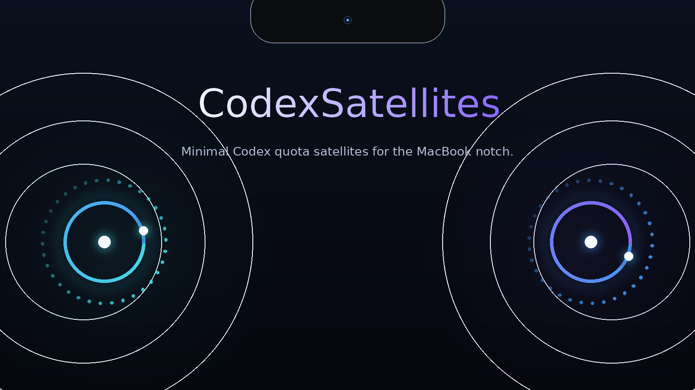
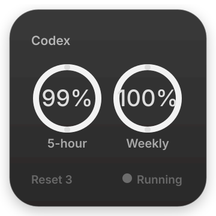
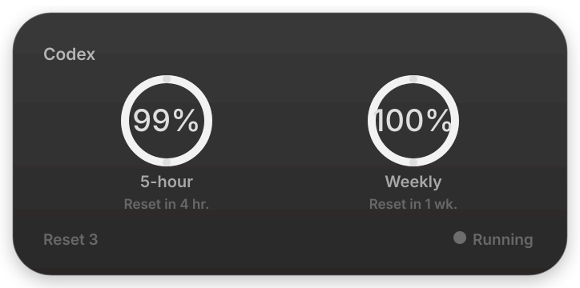

<div align="center">

# CodexSatellites

**Codex quota, quietly at home around your MacBook notch — and on your desktop.**

[](https://github.com/NTLx/CodexSatellites/releases/latest)


[](LICENSE)

[Website](https://ntlx.github.io/CodexSatellites/) · [Download](https://github.com/NTLx/CodexSatellites/releases/latest) · [Release notes](ReleaseNotes/v0.4.0.md)

</div>



CodexSatellites is a small native macOS utility that turns the space beside a MacBook notch into an ambient Codex quota display. The left satellite tracks the **5-hour** window, the right satellite tracks the **weekly** window, and both stay out of the way until you need more detail.

A WidgetKit companion brings the same information to the desktop and Notification Center, including reset credits and the current app status.

> CodexSatellites is an independent community project. It is not affiliated with or endorsed by OpenAI.

## Why CodexSatellites?

- **Ambient by design** — quota is visible where your eyes already are, without another floating window.
- **Native macOS behavior** — SwiftUI, WidgetKit, native notifications, Launch at Login, and system widget editing.
- **No conventional settings window** — controls live where the product lives: beside the notch and in the widget editor.
- **Read-only authentication** — reuses your existing local Codex sign-in without implementing another login flow.
- **Widget without the notch** — the desktop widget works on Macs without a usable hardware notch.
- **No analytics or cloud sync** — CodexSatellites does not add its own telemetry service or account system.

## Install

### Requirements

- **macOS 15 or later**
- an existing **Codex CLI sign-in** on the Mac
- a MacBook with a hardware notch for notch satellites

The WidgetKit widget does **not** require a notch.

### Download and install

1. Download the latest DMG from [GitHub Releases](https://github.com/NTLx/CodexSatellites/releases/latest).
2. Open the DMG and drag **CodexSatellites** into **Applications**.
3. Launch the app.
4. Optionally add the WidgetKit widget from the macOS widget gallery.

> **Why might macOS block the first launch?**
>
> The current public release is ad-hoc signed and not Apple-notarized. If macOS blocks it, use Finder → right-click **CodexSatellites** → **Open**, or approve it in **System Settings → Privacy & Security**. Each release also includes `SHA256SUMS` for independent download verification.

## At a glance

### Notch satellites

| Interaction | Behavior |
| --- | --- |
| Idle | Two compact satellites sit beside the hardware notch. |
| Hover | Both expand to reveal the remaining quota percentages. |
| Click | Opens the compact Settings Bar. |
| Settings Bar | Launch at Login, `1m` / `5m` / `15m` checks, available reset count, and Quit. |

The panels are non-activating and follow the built-in display's camera-housing geometry instead of covering the notch itself.

### Desktop widget

<p align="center">
  
  &nbsp;&nbsp;&nbsp;
  
</p>

| Small | Medium |
| --- | --- |
| 5-hour + weekly remaining quota | 5-hour + weekly remaining quota |
| Available reset count | Available reset count |
| App Running / Stopped status | App Running / Stopped status |
| — | Reset time for each quota window |

Right-click the desktop → **Edit Widgets…** → **CodexSatellites** to add it.

The native **Edit Widget** panel exposes two app-wide settings:

- **Launch at Login**
- **Frequency** — `1m`, `5m`, or `15m`

Clicking the normal widget content performs a **local-only refresh**: it re-reads the app's cached quota/settings data and checks whether CodexSatellites is currently running. It does **not** contact OpenAI, read Codex authentication, or start the app.

## Notifications

CodexSatellites can post native macOS notifications when:

- a quota window returns to **100%**;
- remaining quota falls below **10%**;
- the available reset-credit count changes.

Notification permissions are managed in **System Settings → Notifications**.

## How it works

```text
Existing Codex sign-in
        │
        ▼
 CodexSatellites app ─────► usage endpoint
        │
        ├────► notch satellites
        ├────► native notifications
        │
        └────► local quota/settings snapshots
                         │
                         ▼
                   WidgetKit widget
```

The main app is the only component that reads the existing local Codex authentication state and requests quota data. It classifies the 5-hour and weekly windows from the server-provided durations and publishes widget-safe snapshots locally.

The WidgetKit extension is sandboxed. It never reads Codex authentication and never calls the usage endpoint itself.

## Privacy & security

CodexSatellites is intentionally narrow in what it touches:

- **No separate login or OAuth flow.**
- **No credential storage of its own.**
- **No writes to Codex auth files.**
- **No token refresh performed by CodexSatellites.**
- **No analytics, remote telemetry, or cloud sync added by the project.**
- **Widget access is cache-only.** The sandboxed extension never receives Codex credentials.

The app currently depends on an undocumented ChatGPT usage endpoint, so upstream behavior may change without notice.

## Build from source

Clone the repository, then build and run:

```bash
git clone https://github.com/NTLx/CodexSatellites.git
cd CodexSatellites
./script/build_and_run.sh
```

Build, launch, and verify the running process:

```bash
./script/build_and_run.sh --verify
```

The project targets **macOS 15+** and is written in **Swift / SwiftUI** with a WidgetKit extension.

### Packaging

The current public distribution path does not require an Apple Developer identity:

```bash
./script/release.sh preflight
./script/release.sh adhoc
```

`release.sh adhoc` requires a clean tracked worktree, builds the exact `HEAD`, verifies app/widget versions and ad-hoc signatures, and produces:

```text
dist/CodexSatellites-<version>.dmg
dist/SHA256SUMS
```

`release.sh preview` is a local packaging check. `release.sh all` is retained for a future Developer ID signed + notarized distribution path.

## Project documentation

- [`AGENTS.md`](AGENTS.md) — architecture, invariants, and engineering contract
- [`RELEASE_CHECKLIST.md`](RELEASE_CHECKLIST.md) — release gates and manual verification
- [`ReleaseNotes/`](ReleaseNotes/) — versioned release notes
- [Project website](https://ntlx.github.io/CodexSatellites/) — product overview and install guide

## Contributing

Issues and pull requests are welcome. For substantial changes, review [`AGENTS.md`](AGENTS.md) first: it documents the project's architectural boundaries, WidgetKit constraints, release rules, and source-of-truth conventions.

When changing user-visible behavior, keep the implementation, README, release notes, and website consistent with the actual shipped product.

## FAQ

<details>
<summary><strong>Can I use CodexSatellites on a Mac without a notch?</strong></summary>

Yes — the **WidgetKit widget** works independently of the notch. Only the two notch satellites require a MacBook display with a hardware camera housing.

</details>

<details>
<summary><strong>Does the widget contact OpenAI?</strong></summary>

No. The widget reads only local snapshots written by the main app and checks whether the app is currently running. It never receives Codex credentials and never calls the usage endpoint.

</details>

<details>
<summary><strong>Why does macOS warn about the downloaded app?</strong></summary>

The current public build is ad-hoc signed rather than Developer ID signed and notarized. See [Install](#install) for the first-launch steps, and verify the DMG against the `SHA256SUMS` file attached to the release if desired.

</details>

<details>
<summary><strong>Does CodexSatellites modify my Codex login?</strong></summary>

No. It reads the existing local authentication state, does not perform OAuth itself, does not refresh tokens, and does not write the Codex auth files.

</details>

## Known limitations

<details>
<summary>Current platform and upstream limitations</summary>

- Codex usage depends on an undocumented ChatGPT usage endpoint.
- Full-screen Space behavior has not been explicitly validated.
- CodexSatellites assumes an existing local Codex sign-in and does not manage authentication.
- Notifications require the app to be running and currently use English copy only.
- The public v0.4.0 build is ad-hoc signed, not Developer ID signed, and not notarized.
- WidgetKit stores **Edit Widget** configuration per widget instance while Launch at Login and Frequency are app-global. CodexSatellites reconciles the setting that changed, but WidgetKit has no public API to rewrite the stored editor values in every other widget instance.
- macOS can temporarily keep an older WidgetKit extension process alive after an in-place app update. Timeline reloads are requested, but process recycling remains controlled by the system.

</details>

## License

CodexSatellites is open source under the [MIT License](LICENSE).

---

<div align="center">

**[Website](https://ntlx.github.io/CodexSatellites/) · [Latest release](https://github.com/NTLx/CodexSatellites/releases/latest) · [Source](https://github.com/NTLx/CodexSatellites)**

</div>
